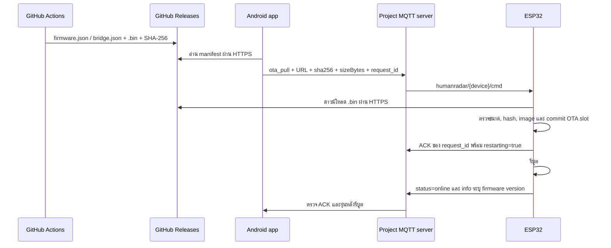

# MQTT และ OTA หลังย้ายเซิร์ฟเวอร์

## เส้นทางการอัปเดต

MQTT ขนส่งคำสั่งและสถานะ ไม่ได้ขนส่งไฟล์ `.bin` การย้ายเครื่องพัฒนาหรือ broker จึงไม่ต้องย้ายไฟล์ firmware จาก GitHub มาโฮสต์เอง ระบบ release เดิมยังอยู่ `.github/workflows/release.yml`

Manifest firmware ปัจจุบัน:

`https://github.com/BungPeerapat/Human_Radar_V2/releases/latest/download/firmware.json`

อีกวิธีคือ Android ดาวน์โหลดและตรวจไฟล์ก่อนส่งแบบ multipart ไป `POST http://{device-ip}/api/firmware-update` ต้องเข้าถึง ESP32 ทาง LAN ได้ วิธีนี้ใช้เป็นทางกู้คืนได้เมื่อ MQTT ไม่พร้อม

## สิ่งที่เปลี่ยน

| ส่วน | การเปลี่ยนแปลง |
| --- | --- |
| Broker หลัก | `systemdeveloper.ddns.net:8883` ใช้ MQTT/TLS |
| WebSocket | WSS `systemdeveloper.ddns.net:9002`, path `/mqtt` |
| Android | ค่าเริ่มต้นใหม่, เปิด TLS/WSS ตาม endpoint, ปุ่มเลือก project broker แบบยืนยันเอง |
| Firmware | ค่าเริ่มต้น TLS และ username ใหม่; CA ISRG Root X1 สำหรับ project broker; รอ SNTP ก่อนตรวจใบรับรอง |
| ค่าที่บันทึกเดิม | ไม่ย้าย host หรือ credentials อัตโนมัติ; ต้องตั้งค่าใหม่โดยชัดเจนเพื่อไม่ทับ custom broker |
| MQTT OTA | Android ส่ง hash/ขนาด; firmware และ bridge ตรวจ HTTPS, Content-Length, ขนาด OTA slot และ SHA-256 ก่อน commit |
| ACK | Android รอคำสั่งที่ device และ request_id ตรงกัน; ACK เริ่มต้นไม่เท่ากับติดตั้งสำเร็จ; แสดง error จากบอร์ดทันที |
| HTTP OTA | ต้องมีผลจบ upload ที่สำเร็จจริง; abort/write failure ไม่ตอบสำเร็จและไม่รีบูตไป image ที่ไม่ผ่าน |
| Config API | ใช้ ArduinoJson แทนการค้นหาข้อความ; รับ spacing/escaping มาตรฐานและรักษาค่าที่ไม่ได้ส่งมา |
| Logging | ไม่ log body ที่มีรหัส WiFi/MQTT ตอนตั้งค่า |
| Bridge | ใช้ downloader เดียวกัน; ยืนยัน pending OTA image ก่อนรอ WiFi; map project WSS ไป TLS `8883` ที่ทราบแน่นอน |
| Toolchain | PlatformIO Espressif32 `6.9.0`, WebSockets `2.7.3`, PubSubClient `2.8.0`, ArduinoJson `7.4.3` |

การตรวจ CA ใหม่ใช้กับ project broker ส่วน custom TLS brokers ยังใช้พฤติกรรมเดิมที่อาจไม่ได้ตรวจ CA ไม่ได้อ้างว่า custom endpoint ทุกแห่งถูกยกระดับการตรวจใบรับรองแล้ว

## ลำดับย้ายอุปกรณ์

1. สำรองค่าปัจจุบันและตรวจว่ามีทางเข้าถึง ESP32 ผ่าน LAN หรือ USB ก่อนเปลี่ยน broker
2. ให้แอปรุ่นใหม่พร้อมก่อน firmware ที่บังคับส่ง SHA-256/sizeBytes; คำสั่งจากแอปเก่าที่ไม่มี metadata จะถูก firmware ใหม่ปฏิเสธ
3. ตั้ง ESP32 เป็น project hostname, TLS/protocol `3`, port `8883`, username และ password ที่ provisioning ให้ ไม่ฝัง secret ลง Git
4. ยืนยัน `humanradar/{device}/status=online` และ `/info` บน broker ใหม่
5. ใน Android ใช้ “Use project MQTT (TLS)” หรือกรอกค่าเอง แล้วใส่ password; profiles/custom preferences เดิมไม่ถูกย้ายโดยอัตโนมัติ
6. ทดสอบ health/config command และข้อมูล targets ก่อนเริ่ม OTA
7. ส่ง OTA พร้อม metadata จาก manifest ที่เชื่อถือได้ ยืนยัน ACK แล้วตรวจรุ่นหลังรีบูต
8. ทดสอบอัปเดตซ้ำและแผนกู้คืนก่อนย้ายอุปกรณ์ทั้งหมด อย่าปิดช่องทางเดิมที่ยังมีอุปกรณ์พึ่งพา

สำหรับบอร์ดนี้ broker เก่าเสียอยู่แล้ว จึงใช้ LAN ตั้งค่าใหม่และรักษา WiFi/NVS จากสำรอง ไม่ได้ปิดบริการ broker เก่าเพิ่มเติม

ถ้าย้ายเครื่องอีกครั้งโดยคง hostname, ports, credentials และ topics เดิมไว้ การเปลี่ยน DNS และติดตั้ง broker/certificate/ข้อมูล persistence บนเครื่องใหม่ไม่ต้องเปลี่ยน URL firmware ที่อยู่ GitHub หากเปลี่ยน hostname หรือรูปแบบ transport ต้องตรวจทั้ง app preferences, NVS, project endpoint constants/bridge mapping และ trust anchors แล้วจัดลำดับย้ายก่อนปิดช่องทางเดิม

Firmware เดิมก่อนแก้ parser ต้องใช้ JSON แบบ compact เช่น `{"mh":"host","mp":8883}` การส่งค่าสตริงที่มีช่องว่างหลัง `:` อาจทำให้ค่าเดิมถูกล้าง Firmware ใหม่รองรับ JSON มาตรฐานและปฏิเสธชนิดข้อมูลไม่ถูกต้องก่อนแก้ค่า

## Timeout และการตรวจไฟล์

OTA pull ต้องใช้ HTTPS, SHA-256 แบบ hex 64 ตัว และขนาดบวกที่ไม่เกิน OTA slot เซิร์ฟเวอร์ดาวน์โหลดต้องมี Content-Length ตรงกับ manifest; ไม่รับ stream ที่ไม่ทราบขนาดหรือ chunked encoding ผ่าน raw stream นี้

TLS handshake กำหนด timeout 5 วินาที, connect 5 วินาที, header read inactivity 15 วินาที และ redirects ไม่เกิน 3 ครั้ง ระหว่าง GET พัก watchdog subscription ของ loop task ชั่วคราวแล้วคืนเมื่อ GET กลับ เพื่อไม่ให้ watchdog รีเซ็ตกลางการเชื่อมต่อ

ช่วงรับ body ปฏิเสธเมื่อไม่มีข้อมูลเกิน 60 วินาทีหรือ transfer เกิน 180 วินาที กำหนดเวลารับ body เริ่มหลัง GET; header inactivity timeout ไม่ใช่ deadline รวมแบบ wall clock จึงไม่อ้างว่าคำขอทุกกรณีจบภายใน 180 วินาที

Hash ยืนยันว่าไฟล์ตรงกับ metadata ที่ได้รับ ไม่ได้ทดแทน digital signature ต้องรักษาความปลอดภัยของ MQTT account, manifest และระบบ release ด้วย

## Recovery และข้อจำกัดที่ต้องรู้

- ถ้า download/hash/size ผิด จะ abort และไม่เปลี่ยน boot partition ของ image ปัจจุบัน
- การเขียน OTA ที่ไม่สำเร็จอาจทำให้ image เก่าใน inactive slot ใช้ไม่ได้ อย่าสันนิษฐานว่ามี rollback image ที่สมบูรณ์เสมอ
- ตรวจ manual rollback ด้วย `/api/firmware-rollback` และยืนยันรุ่นหลัง reboot จริง; HTTP ตอบสำเร็จเพียงอย่างเดียวไม่พิสูจน์ว่า rollback สำเร็จ
- แอปหลักและ bridge ยืนยัน pending image เมื่อเริ่มทำงาน การยืนยันนี้ไม่ใช่การทดสอบสุขภาพ radar/network แบบครอบคลุม
- ความสามารถ auto rollback ขึ้นกับ bootloader ที่ติดตั้งจริง ห้ามสรุปจากการมี API หรือ macro ใน SDK เพียงอย่างเดียว
- Bridge ไม่มี WebSocket library: project WSS map ไป project TLS port ได้; custom WS/WSS ไม่เดา port ต้องตั้ง TCP/TLS ที่ถูกต้องก่อนเข้า bridge
- Bridge อ่าน WiFi/NVS เดิมและไม่มีหน้า AP ตั้งค่า ถ้า WiFi ใช้ไม่ได้อาจต้อง USB
- Initial provisioning, boot ไม่ขึ้น หรือเข้าถึงเครือข่ายไม่ได้ยังอาจต้องใช้ USB; การพัฒนาผ่าน SSH ไม่ทำให้มองเห็น COM port ของ Windows อัตโนมัติ

## ขั้นตอนกู้คืนเมื่ออัปเดตมีปัญหา

1. เก็บ request_id, error ACK, รุ่นก่อนอัปเดต และ status/info หลังเหตุการณ์ก่อนส่งคำสั่งซ้ำ อย่าถือว่า progress 100% เท่ากับติดตั้งสำเร็จ
2. หากบอร์ดยังออนไลน์แต่ดาวน์โหลดไม่ผ่าน ให้ตรวจ URL/HTTPS, SHA-256, sizeBytes และขนาด slot จาก manifest กับไฟล์จริง แก้สาเหตุแล้วส่ง OTA ใหม่พร้อม request_id ใหม่
3. หาก MQTT ใช้ไม่ได้แต่ LAN ยังเข้าได้ ตรวจ `GET /health` และ `GET /api/version` ที่ IP ปัจจุบันของบอร์ด ใช้หน้าเว็บ/Android HTTP upload กับ image ที่ตรวจ hash แล้วเพื่อกู้ firmware โดยรักษาค่า WiFi/NVS
4. ใช้ `POST /api/firmware-rollback` เฉพาะเมื่อทราบว่า inactive slot มี image สมบูรณ์ที่ต้องการกลับไป การเขียน OTA ที่ล้มเหลวอาจทับ slot นั้นแล้ว หลังสั่งต้องตรวจรุ่นและ health ใหม่
5. หาก firmware หลักทำงานไม่ได้แต่ bridge ยังเข้าถึงได้ ให้ OTA image หลักผ่าน bridge พร้อม metadata ที่ถูกต้อง โดยใช้ project TLS endpoint; bridge ไม่มีหน้า AP ตั้งค่า
6. หากบูตไม่ขึ้นหรือไม่มีทั้ง LAN/MQTT ให้ใช้ USB กับเครื่องที่เสียบบอร์ดและแผนกู้คืนเฉพาะอุปกรณ์ ห้ามใช้ full-flash backup ที่ checksum ไม่ผ่านหรือ factory reset เพียงเพื่อทดลองแก้เครือข่าย

สำหรับการตัดไฟทดสอบ ต้องได้รับสัญญาณว่าผู้ใช้พร้อมก่อนเริ่ม รอ progress ที่แสดงว่ากำลังเขียนจริงแล้วจึงเรียกผ่าน LINE ให้ถอด USB ประมาณ 5 วินาทีและเสียบกลับโดยไม่กด BOOT เก็บรุ่น/boot count ก่อนและหลัง ตรวจว่ากลับมาออนไลน์ แล้วอัปเดตอีกครั้งจนยืนยันรุ่นใหม่ได้ หากผู้ใช้ถอดไม่ทันก่อน commit ให้บันทึกว่าไม่ใช่การทดสอบตัดไฟระหว่างเขียนและยังไม่ผ่านเกณฑ์นี้

## Checklist ก่อน release และ rollout

- [x] Android, firmware หลัก, Arduino tree และ bridge มี implementation ตรงกันและ build/test ตามผลที่บันทึก
- [x] ตรวจ auth/ACL, TLS/WSS, broker restart และ OTA/recovery บนบอร์ดทดสอบตามผลในเอกสาร
- [x] Git checkout บนเซิร์ฟเวอร์รับ implementation และเอกสารที่ commit แล้ว; ไม่ได้เผยแพร่ release ใหม่บน GitHub
- [x] ผ่านการตัดไฟที่ progress 19% และ OTA รอบถัดไปบนบอร์ดจริง พร้อม raw evidence
- [x] มี targets จาก HLK-LD2450 จริงผ่าน MQTT ถึง Android emulator
- [ ] แก้ brownout ของบอร์ดทดสอบและยืนยัน health/targets ต่อเนื่องหลังแก้ไฟเลี้ยง
- [x] เผยแพร่ signed v1.1.0 ด้วยคีย์เดิมและ manifest versionCode 91; ผู้ใช้ยืนยันอัปเดตแล้วต่อ MQTT ได้
- [ ] หลัง hardware gates ผ่าน ให้คืนค่าบอร์ดเป็น transport ที่ต้องการใช้งาน ตรวจ health/config/OTA และคง provisioning ของอุปกรณ์
- [x] ปิด HTTPS container ทดสอบและลบ UFW rules 9443 เฉพาะงานนี้แล้ว; recovery binaries ยังคงอยู่และใช้ public GitHub OTA ได้
- [ ] สรุปผลสุดท้าย ย้าย Tasks 001–002 ไป done และอัปเดต checkout บนเซิร์ฟเวอร์ก่อน rollout

## หลักฐานการตรวจรับ

ดูผลปัจจุบันใน `docs/MQTT_OTA_TEST_RESULTS.md` และ `tasks/doing/` หรือ `tasks/done/` การ build, host simulation และ static review ใช้เสริมหลักฐาน แต่ไม่แทนการอัปเดตบน ESP32 จริง
